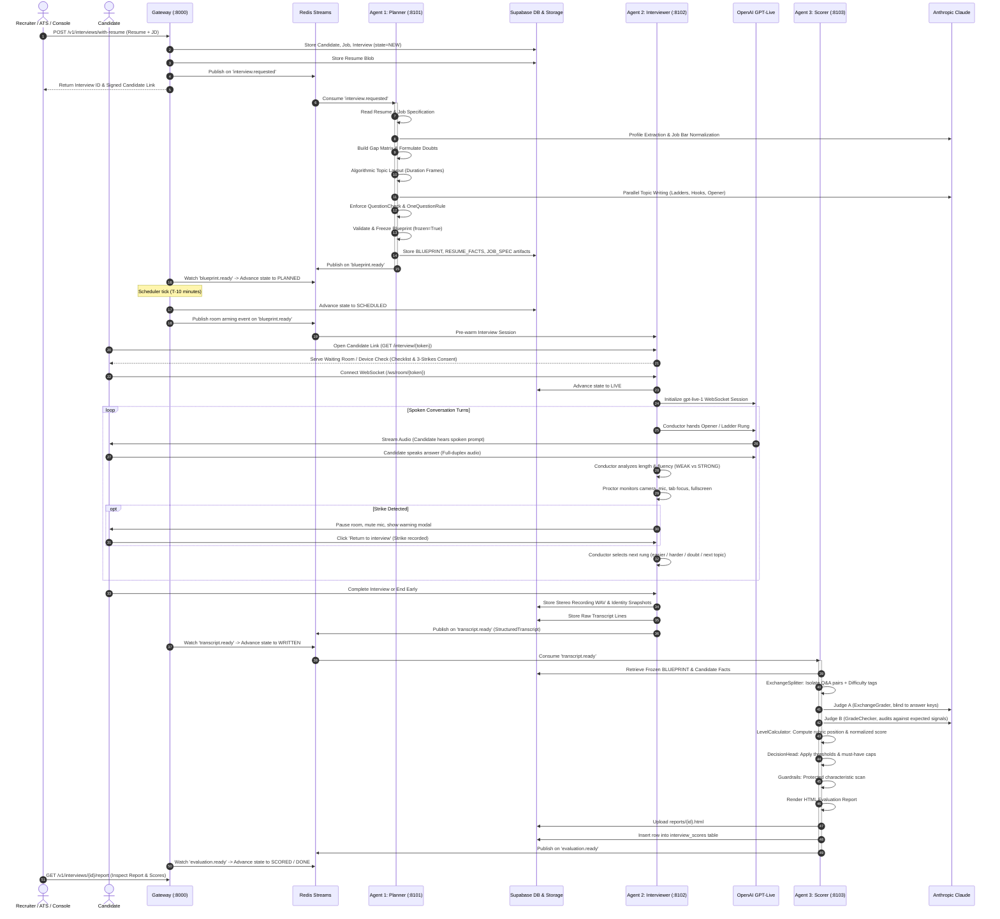

# OxiqAI Interview Agent — Comprehensive System Architecture & Engineering Report

---

## 1. Executive Summary & Project Overview

The **OxiqAI Interview Agent** is an enterprise-grade, autonomous technical interview platform engineered to conduct, supervise, and evaluate spoken job interviews in real time. Built with an asynchronous, decoupled, multi-agent microservice architecture, the platform replaces rigid, pre-scripted question bots with an adaptive, conversational interviewer that evaluates candidates against standardized job bars while tailoring every conversation to the candidate's unique resume, claims, and demonstrated performance.

### 1.1 Core Mission & Objectives
* **Objective Evaluation**: Standardize the hiring bar for every job so that all candidates for a role are evaluated against identical competencies, weights, and rubric anchors, even though no two candidates hear the exact same questions.
* **Full-Duplex Natural Spoken Dialogue**: Provide a low-latency, voice-first candidate experience capable of handling interruptions, clarifications, thinking pauses, and natural turn-taking using native real-time audio models.
* **Dynamic Difficulty Laddering**: Adjust question difficulty in real time based on candidate answers, escalating to harder problems when a candidate excels and providing accessible entry points when they struggle.
* **Comprehensive Integrity & Proctoring**: Continuously monitor the interview environment for academic dishonesty, unauthorized external assistance, devtools access, window switching, and answer-fishing while preserving fairness through clear candidate safeguards (e.g., the Three-Strike Rule).
* **Transparent & Explainable Scoring**: Eliminate opaque "black box" model ratings. Scores are deterministically computed from multi-judge graded question-answer exchanges, backed by verbatim quotes from the candidate, and linked directly to rubric levels.

### 1.2 The Five Architectural Invariants
The system enforces five strict architectural rules to guarantee microservice isolation, horizontal scalability, and auditability:
1. **No Agent Imports Another Agent's Code**: Services share zero internal logic.
2. **No Direct Agent-to-Agent Calls**: Communication happens solely through asynchronous message passing over an event bus.
3. **Contracts are the Only Shared Code**: All shared data models are defined strictly in the versioned `contracts/` package.
4. **Large Payloads Go to Blob Storage**: Messages carry metadata and storage URIs; raw audio files, videos, and full HTML reports never traverse the message bus.
5. **Idempotency & Reproducibility**: Processing the same message multiple times yields the exact same state and evaluation. Blueprints are immutable once frozen.

*(Note: In accordance with project requirements, the separate Recruitment Onboarding Product is outside the scope of this report.)*

---

## 2. High-Level Architecture & Infrastructure Topology

```
                       ┌────────────────────── MESSAGE BUS (Redis Streams) ──────────────────────┐
                       │  interview.requested    blueprint.ready                                  │
                       │  transcript.ready       evaluation.ready                                 │
                       └───┬──────────────────────┬────────────────────────┬──────────────────────┘
                           │                      │                        │
  GATEWAY (Control Plane) ─┘                      │                        │
  • Port 8000                                     │                        │
  • REST API & Candidate Links                    │                        │
  • /console Web Interface                        │                        │
  • Room Arming Scheduler                         │                        │
                                                  │                        │
                       AGENT 1: PLANNER ──────────┴► AGENT 2: INTERVIEWER ─┴► AGENT 3: SCORER
                       • Port 8101                   • Port 8102               • Port 8103
                       • Reads Resume & Job Spec     • Live Voice Room         • Graded Exchanges
                       • Produces Frozen Blueprint   • Dynamic Laddering       • Multi-Judge Scoring
                       • Stateless Replicas          • Full-Duplex Audio       • Claude-Only Analysis
```

### 2.1 Service Breakdown & Port Allocation
* **Gateway (`gateway/`, Port 8000)**: The central control plane. Manages interview bookings, signs and validates candidate link tokens, schedules room arming, tracks state transitions, initiates automated re-interviews on system faults, and serves the operator console.
* **Agent 1: Planner (`agent1_planner/`, Port 8101)**: The planning agent. Consumes `interview.requested`, reads the candidate's resume, normalizes the job description, builds a competency gap matrix, flags resume doubts, algorithmically designs topic timeboxes, and synthesizes an adaptive difficulty ladder into an immutable `InterviewBlueprint`. Emits `blueprint.ready`.
* **Agent 2: Interviewer (`agent2_interviewer/`, Port 8102)**: The stateful conversational agent. Consumes `blueprint.ready`, serves the zero-dependency candidate frontend, hosts full-duplex live audio rooms over WebSockets using `gpt-live-1`, enforces proctoring policies, and records stereo audio and identity captures. Emits `transcript.ready`.
* **Agent 3: Scorer (`agent3_scorer/`, Port 8103)**: The evaluation agent. Consumes `transcript.ready`, loads the frozen blueprint and candidate facts, splits exchanges, executes dual-judge evaluation via Claude Sonnet 3.5/Opus, computes mathematical rubric levels, validates fairness guardrails, and renders an executive HTML report. Emits `evaluation.ready`.

### 2.2 Shared Infrastructure
* **Message Bus (Redis Streams)**: Distributed message broker managing five primary topics:
  * `interview.requested`: Triggered by Gateway upon candidate booking.
  * `blueprint.ready`: Emitted by Agent 1 when the conversation map is validated and frozen; also used by Gateway to arm rooms.
  * `transcript.ready`: Emitted by Agent 2 upon interview completion or early termination.
  * `evaluation.ready`: Emitted by Agent 3 when multi-judge scoring and report rendering are complete.
  * `agent.failed`: Emitted if an unrecoverable service error occurs during queue processing.
* **Database (PostgreSQL / Supabase)**: Relational persistent store maintaining interview records, candidate profiles, raw transcript lines, red flags, structured transcripts, evaluations, and auditable score cards.
* **Blob Store (Supabase Storage / AWS S3 / Local Disk)**: Object storage containing candidate resumes (`request.resume_uri`), stereo session recordings (`recordings/{id}.wav`), identity verification snapshots (`identity/{id}/*`), and executive HTML reports (`reports/{id}.html`).

### 2.3 Universal Agent Framework (`common/app.py`)
To ensure complete interchangeability and modularity, every agent microservice is constructed using the `create_agent_app(spec: AgentSpec)` factory. This guarantees an identical operational surface across all services:
* `GET /healthz`, `GET /readyz`: Liveness and readiness probes for orchestrators (Kubernetes/Compose).
* `GET /metrics`: Native Prometheus instrumentation tracking run latencies (`agent_run_seconds`), execution counters (`agent_runs_total`), and active in-flight jobs (`agent_inflight`).
* `GET /v1/contract`: Dynamically exposes the service's JSON Schema for accepted inputs, generated outputs, and subscribed topics.
* `GET /v1/config`, `PUT /v1/config`: Inspect and dynamically hot-reload configuration parameters at runtime.
* `POST /v1/attach`: Dynamically redirects an agent's output sink to another Redis stream topic or an external webhook URL (e.g., direct ATS integration).
* `POST /v1/run`: Synchronously executes a single job in-memory for testing or pipeline chaining.
* `POST /v1/jobs` & `GET /v1/jobs/{id}`: Asynchronously dispatches a background task and permits polling.

---

## 3. Data Contracts & Shared Specifications

The `contracts/` directory represents the sole code dependency shared between the agents. Contracts are strictly versioned (`VERSION = 1` or `VERSION = 2`), and models strictly forbid the removal of fields within a version to preserve backward compatibility.

```
       [ Gateway ]
            │  (PlannerInput via Envelope)
            ▼
    [ Agent 1: Planner ]
            │  (InterviewBlueprint v2 via Envelope + Repository Artifacts)
            ▼
   [ Agent 2: Interviewer ]
            │  (StructuredTranscript v1 via Envelope)
            ▼
    [ Agent 3: Scorer ]
            │  (Evaluation v2 via Envelope + Supabase Table)
            ▼
    [ Gateway / ATS ]
```

### 3.1 Bus Envelope (`contracts/events.py`)
Every packet traveling across Redis Streams is encapsulated within an `Envelope`:
* `message_id`: Unique identifier (`msg_<hex16>`).
* `topic`: Target stream name (`interview.requested`, `blueprint.ready`, etc.).
* `interview_id`: Global unique interview identifier (`int_<hex>`).
* `contract`: Name of the payload contract (`InterviewBlueprint`, `StructuredTranscript`, `Evaluation`).
* `version`: Version integer of the schema.
* `produced_by`: Identifier of the emitting service (e.g., `agent1_planner`).
* `produced_at`: UTC ISO timestamp.
* `payload`: Inline JSON dictionary for small data structures.
* `payload_uri`: Storage URI if the payload exceeds inline size thresholds.
* `attempt`: Integer retry counter for dead-letter processing.
* `trace_id`: Distributed tracing UUID.

### 3.2 Contract 1: `InterviewBlueprint v2` (`contracts/blueprint.py`)
Agent 1's published artifact and message payload. Rather than a rigid list of questions, the blueprint defines a **dynamic conversation map**:

```
InterviewBlueprint v2
├── bar (Fixed per Job Specification)
│   ├── job_key (Hash of description, role, seniority)
│   ├── seniority (intern | junior | mid | senior | staff)
│   ├── competencies: [ { name, description, weight, must_have, behavioural } ]
│   └── rubric: [ { competency, levels: [ { level: 1..10, anchor } ] } ]
├── candidate (Extracted Profile)
│   ├── timeline: [ { what, kind, start, end, highlights, span_ref } ]
│   ├── claims: [ { text, span_ref } ]
│   ├── estimated_level: (intern | junior | mid | senior | staff)
│   ├── level_basis: (Rationale for estimated level)
│   └── reduced_context: bool (True if resume was unparseable)
├── gap_matrix: [ { competency, state: verified_on_paper|unverified|missing|overclaimed, probe_priority } ]
├── doubts: [ { id, kind: timeline_gap|vague_role|unbacked_skill|overclaim|level_mismatch, about, ask, resolved_when } ]
├── topics: [ (Ordered conversation sequence)
│   ├── id, kind (opening | background | project | technical | scenario | behavioural | candidate_q | close)
│   ├── title, goal, opener, bridge_in, source_ref
│   ├── ladder: [ { difficulty: 1..5, ask, expected_signals, red_flags } ]
│   ├── start_rung: int (Index into ladder determined by estimated_level)
│   ├── hooks: [ { if_mentioned, then } ]
│   ├── doubts: [ doubt_ids ]
│   ├── time: { min_s, target_s, max_s }
│   └── must_cover: bool, optional: bool
├── role_brief (Safe context for answering candidate questions)
└── frozen: bool (Must be True before Agent 2 can run)
```

#### Blueprint Validation Rules (`assert_valid()`)
Before freezing, Agent 1 asserts strict invariants:
1. `FIRST` topic must be `opening`; `LAST` topics must be `candidate_q` and `close`.
2. Every competency defined in `bar` must have a corresponding rubric anchor.
3. Every must-have competency in `bar` must be assigned to at least one `must_cover` topic.
4. Total planned time across non-optional topics must not exceed usable interview duration (`duration_s - reserve_s`).
5. Total planned time must occupy at least 80% of usable interview duration (rejecting under-planned interviews).
6. Ladder difficulty must strictly increase or stay equal as rungs climb.

### 3.3 Contract 2: `StructuredTranscript v1` (`contracts/transcript.py`)
Produced by Agent 2 upon the conclusion of a session. It organizes raw audio dialogue into semantically indexed blocks:
* `question_blocks`: Sequence of `QuestionBlock` objects corresponding to blueprint topics:
  * `question_id`: The topic ID.
  * `stage`: The topic kind (`project`, `technical`, etc.).
  * `utterances`: List of dialogue turns (`Speaker.BOT`, `Speaker.CANDIDATE`, `Speaker.SYSTEM`).
  * `rung`: Exactly which ladder difficulty rung was handed to the voice on that turn.
  * `doubt_id`: The specific resume doubt being probed.
  * `signals`: Real-time competencies observed during the block.
  * `rungs_asked`, `doubts_raised`: Summary lists for the topic.
* `red_flags`: Real-time integrity events emitted by proctoring:
  * `kind`: `tab_blur`, `fullscreen_exit`, `paste`, `copy`, `second_screen`, `devtools`, `no_face`, `multiple_faces`, `camera_off`, `second_voice`, `automation`, `answer_seeking`, `left_interview`, `strikes_exhausted`, `question_echo`.
  * `severity`: `info`, `low`, `medium`, `high`.
  * `at_s`: Timestamp relative to session start.
* `recording_uri`: Storage link to the synchronized stereo WAV recording (Candidate Left, Interviewer Right).
* `identity_captures`: Metadata and storage links to webcam captures taken at join and during checkpoints.
* `completion`: State enum (`full`, `partial`, `aborted_early`).
* `system_fault`: Boolean flag indicating whether the session failed due to internal infrastructure issues (e.g., lost voice model connection, empty plan). If `True`, the interview is **never penalized** and a re-interview is automatically scheduled.
* `integrity_score()`: Deterministic mathematical formula computing candidate integrity ($0.0$ to $1.0$):
  $$\text{Integrity} = \max\left(0.0, 1.0 - \sum \text{weight}[\text{severity}] \times \min(\text{count}, 5)\right)$$
  *(Weights: High = 0.20, Medium = 0.07, Low = 0.02, Info = 0.00)*

### 3.4 Contract 3: `Evaluation v2` (`contracts/evaluation.py`)
Produced by Agent 3 and delivered to the Gateway and hiring systems:
* `scores`: Per-competency evaluation breakdown (`CompetencyScore`):
  * `competency`: Name of the skill.
  * `score`: Integer on a 1–5 scale.
  * `rubric_position`: Floating-point position across the rubric scale.
  * `normalised`: Normalized float ($0.0$ to $1.0$).
  * `difficulty_reached`: Highest ladder difficulty answered adequately.
  * `difficulty_expected`: Target difficulty for the role's seniority.
  * `proof`: Verbatim quotes extracted from candidate utterances with exact timestamps.
  * `rationale`: 1–3 sentence analytical justification.
  * `confidence`: Statistical confidence score ($0.0$ to $1.0$).
* `exchanges`: Graded records of each individual Q&A interaction (`ExchangeGrade`):
  * `difficulty`: Rung difficulty (1–5).
  * `asked`: Verbatim question asked by the interviewer.
  * `verdict`: `strong` | `adequate` | `weak` | `wrong` | `no_answer`.
  * `own_work`: Boolean confirming candidate spoke from personal experience.
  * `reasoning`: Boolean confirming candidate articulated causal rationale.
  * `interviewer_led`: Boolean identifying if candidate merely repeated interviewer prompts.
  * `check`: Second-judge agreement (`agree`, `too_high`, `too_low`).
* `resume_check`: Verification status of claims and planner doubts (`proven`, `unclear`, `contradicted`, `not_discussed`).
* `total_0_100` & `total_0_10`: Weighted headline scores.
* `outcome`: Final classification (`strong_fit`, `fit`, `borderline`, `no_fit`).
* `coverage`: Percentage of required topics reached (unreached topics incur no penalty).
* `integrity_score`: Carried over from transcript analysis.
* `needs_human_review`: Boolean flag triggered if confidence is low, integrity flags exist, or protected characteristics were discussed.
* `report_uri`: Signed URL to the self-contained HTML evaluation report.

---

## 4. Agent 1: The Planner — Deep Dive & Workflow

The Planner transforms static application materials (resume, job description, company guidelines, and GitHub profiles) into a dynamic, execution-ready conversation map.

```
[ PlannerInput ]
       │
       ▼
 1. ResumeReader ────────► Extracts plain text from PDF/TXT; handles unreadable files safely
       │
 2. JobBank & JDNormalizer► Extracts competencies, must-haves, rubric anchors; caches per job
       │
 3. ProfileBuilder ──────► Extracts timeline, claims, and calculates estimated_level
       │
 4. GithubEnricher ──────► (Optional) Gathers public repo statistics and commit data
       │
 5. GapMatrixBuilder ────► Classifies competencies: verified | unverified | missing | overclaimed
       │
 6. DoubtFinder ─────────► Synthesizes resume doubts (vague roles, timeline gaps, overclaims)
       │
 7. TopicPlanner ────────► Algorithmic layout: topic kinds, duration frames, ladder difficulty targets
       │
 8. TopicWriter ─────────► Parallel LLM generation: specific questions, rungs, hooks, red flags
       │
 9. Rule Enforcement ────► QuestionCheck (anti-template filter) + OneQuestionRule (split questions)
       │
10. MapValidator & Freeze► Validates coverage, time budgets, and freezes blueprint (immutable)
       │
       ▼
[ Publish Artifacts ] ───► Stores BLUEPRINT, RESUME_FACTS, JOB_SPEC; emits blueprint.ready
```

### 4.1 Detailed Pipeline Steps
1. **Resume Ingestion (`ResumeReader`)**:
   * Reads raw resume text directly or retrieves file blobs from Supabase/S3.
   * If parsing fails or the resume is corrupted, the service activates `reduced_context=True`, planning the interview solely from the job description while logging an audit flag. It **never fails silently**.
2. **Job Normalization & Caching (`JobBank`, `JDNormalizer`)**:
   * Computes a deterministic `job_key` (hash of job description, company requirements, seniority, and role title).
   * Generates or retrieves from cache the normalized `JobSpec`: core competencies, must-have flags, nice-to-haves, weights, and behavioural competencies. This ensures every candidate for the same job faces identical standards.
3. **Candidate Profiling (`ProfileBuilder`)**:
   * Executes a structured LLM pass to parse candidate history into a typed timeline (education, work, projects), key skills, technical projects, and explicit claims.
   * Derives an independent `estimated_level` (`intern` to `staff`) based purely on concrete actions described in the resume, which may differ from the recruiter's booked level.
4. **GitHub Enrichment (`GithubEnricher`)**:
   * If a GitHub profile URL is supplied, queries public repositories to gather primary languages, repository descriptions, and project scopes to seed practical discussion topics.
5. **Gap Analysis (`GapMatrixBuilder`)**:
   * Cross-references candidate profile entries and GitHub data against the `JobSpec` competencies.
   * Assigns each required competency a `GapState`:
     * `VERIFIED_ON_PAPER`: Explicit, corroborated evidence found.
     * `UNVERIFIED`: General mention without verifiable technical depth.
     * `MISSING`: No record found on resume.
     * `OVERCLAIMED`: High-level headline assertion unsupported by project details.
6. **Doubt Formulation (`DoubtFinder`)**:
   * Automatically formulates targeted investigative doubts (`DoubtKind`):
     * `TIMELINE_GAP`: Unexplained gaps or suspicious overlapping dates.
     * `VAGUE_ROLE`: High-level job titles lacking technical context.
     * `UNBACKED_SKILL`: Technologies listed in skills blocks but unused in project descriptions.
     * `OVERCLAIM`: Discrepancy between stated responsibility and tangible deliverables.
     * `LEVEL_MISMATCH`: Mismatch between booked seniority and resume track record.
   * Caps active doubts based on interview duration ($\lfloor \text{duration\_min} / 5 \rfloor$, bounded between 2 and 6).
7. **Algorithmic Conversation Layout (`TopicPlanner`)**:
   * Operates purely via deterministic code logic prior to generating specific question texts.
   * Computes topic time allocations using standard duration frames (e.g., a 15-minute screen allocates ~90 seconds per question across 7 distinct topics; longer sessions allocate 150–180 seconds).
   * Structures the mandatory sequence:
     $$\text{Opening} \longrightarrow \text{Background} \longrightarrow \text{Projects} \longrightarrow \text{Technical} \longrightarrow \text{Scenario} \longrightarrow \text{Behavioural} \longrightarrow \text{Candidate Q\&A} \longrightarrow \text{Close}$$
   * Ensures every `must_have` competency is mapped to a `must_cover` topic. Allocates exactly one `optional` topic to absorb spare time if the candidate moves rapidly.
   * Assigns difficulty ladders: Main question at role baseline (`BAR_DIFFICULTY`), easier rung at $-1$, and stretch rung at $+1$.
8. **Parallel Topic Writing (`TopicWriter`)**:
   * Dispatches parallel LLM calls (`effort: medium`) to craft specific wording for each topic slot.
   * Each call is provided with the full draft outline to ensure smooth transitions (`bridge_in`) and eliminate repetitive queries.
   * For each topic, generates:
     * `opener`: Main starting question (identical to the middle ladder rung).
     * `ladder`: Rungs covering easier, main, and harder variants, complete with expected candidate signals (hidden from interviewer) and interview red flags.
     * `hooks`: Conditional branches (*"If candidate mentions Kafka, ask how they handled consumer lag"*).
     * `doubts`: Natural conversational prompts to clarify resume ambiguities.
9. **Automated Quality Filtering & Guardrails**:
   * **`QuestionCheck`**: Scans generated text to reject academic exam phrasing (*"Explain the concept of..."*, *"Where have you used..."*), questions exceeding 40 words, or questions referencing uncorroborated sources. Violations trigger one regeneration pass, failing over to tested fallback wording.
   * **`OneQuestionRule`**: Identifies double-barreled questions (*"What was the architecture and how did you scale it?"*) and automatically truncates the prompt to the primary clause.
10. **Validation & Blueprint Freezing (`MapValidator`)**:
    * Verifies all schema constraints, time floors, and competency mappings.
    * Sets `frozen=True`. The plan is permanently locked to guarantee evaluation reproducibility.
11. **Artifact Publication**:
    * Persists `BLUEPRINT`, `RESUME_FACTS`, and `JOB_SPEC` to the durable repository.
    * Publishes `Envelope` with `blueprint.ready` to Redis Streams.

---

## 5. Agent 2: The Interviewer — Deep Dive & Workflow

Agent 2 is the only stateful service in the cluster. It manages real-time audio streaming, controls conversation pacing via the Conductor, monitors proctoring signals, and records interview evidence.

```
[ Candidate Browser ]
       │
       ▼ (WebSocket /ws/room/{token})
[ Agent 2: Interviewer Session ]
       │
       ├──► Frontend Engine: Waiting Room ──► Device Check ──► Live Stage ──► Exit
       │
       ├──► Conductor: Code owns the questions; voice owns the manners
       │    ├── Selects ladder rung (easier / harder) based on answer length & confidence
       │    ├── Handles stalls (1.5s - 3s), move-on requests, topic timeouts
       │    └── Drops optional topics when behind schedule; protects must-covers
       │
       ├──► Live Audio Engine (GPT-Live WebSocket)
       │    ├── Model: gpt-live-1 (refuses all other models)
       │    ├── Full-duplex speech-to-text and text-to-speech
       │    ├── Reconnect watchdog with conversation memory digest
       │    └── Anti-cheat prompt decliners
       │
       ├──► Proctoring Engine (proctor.py)
       │    ├── Three-Strike Rule: Fullscreen exit / blur pauses room and costs 1 strike
       │    ├── Browser signals: DevTools, copy/paste, multi-face, second screen
       │    └── Heuristic analysis: Answer-seeking, Question-Echo, pause-then-fluent
       │
       └──► Evidence Collector (evidence.py)
            ├── Stereo WAV: Candidate (Left Channel) | Interviewer (Right Channel)
            └── Periodic identity verification snapshots (join + 4 intervals)
```

### 5.1 Frontend Candidate Journey (`agent2_interviewer/frontend`)
The candidate room is served directly by Agent 2 as a zero-dependency, self-contained single-page application (no CDNs, external scripts, or external web fonts):
1. **Waiting Room**:
   * Live countdown timer synchronized with the interview's `scheduled_at` timestamp in the candidate's local time zone.
   * Checklist covering camera, microphone, quiet environment, and network requirements.
   * Automatically transitions into the device check when the room opens (10 minutes prior to scheduled start) without requiring a browser refresh.
2. **Device Pre-Flight Check**:
   * Interactive camera preview and live microphone audio volume meters.
   * Device selection dropdowns for system microphones and webcams.
   * Speaker test audio playback button.
   * System verification checklist: Single display check, browser fullscreen capability, and media permissions.
   * **Mandatory Agreement**: The candidate must actively check a prominent red acknowledgement box explaining the strict **Three-Strike Rule** and consent to video and audio recording.
3. **Live Interview Stage**:
   * Designed with a clean, distraction-free aesthetic (navy `#0A1834` and cyan `#4DE1EE`).
   * **3D AI Interviewer Visualizer**: Features a circular portrait of the interviewer surrounded by an audio-reactive, rotating glowing aura. The portrait physically lifts and the aura expands dynamically based on the audio frequency spectrum of the synthesized voice.
   * Status indicator pill displaying the current conversational phase: `Speaking`, `Listening`, `Paused`, or `Reconnecting`.
   * Candidate self-view thumbnail in the corner that illuminates when speech input is detected.
   * Real-time interview countdown clock displaying remaining time.
   * Persistent bottom control bar with microphone, camera, and fullscreen toggles, alongside a confirmed `End Interview` action.
4. **Exit Screen**:
   * Displays confirmed finish timestamp, total session duration, and an explanation of the subsequent hiring process.
   * If an internal system failure occurred, the exit screen displays an immediate notification that a complimentary re-interview will be scheduled.

### 5.2 The Conductor (`conductor.py`)
The Conductor is a deterministic state machine governing the progression of the interview. **The code owns the questions; the voice model owns only the conversational manner.**
* **Speech Scaffolding**: The Conductor injects the exact wording for each topic opener and ladder rung into the voice model. The model is permitted to add brief natural conversational transitions but is strictly prohibited from inventing arbitrary interview questions.
* **Dynamic Ladder Navigation**: After each candidate response, the Conductor evaluates candidate fluency using fast heuristics (avoiding slow LLM calls mid-interview):
  * **Weak / Hesitant Response** ($< 20$ words, or phrases matching `I don't know`, `not sure`, `never worked with`): Conductor descends to the **Easier Rung** or offers a clarifying prompt.
  * **Strong / Fluent Response** ($> 60$ words, or rich technical detail delivered with ample time remaining): Conductor ascends to the **Harder Rung** to test technical limits.
  * **Resume Doubt**: Probes an unverified claim or timeline gap associated with that topic.
* **Conversational Turn Management**:
  * **Stall Watchdog**: If the voice acknowledges an answer (*"Got it."*) and pauses for more than $1.5\text{ s}$ ($2.5\text{ s}$ for murmurs like *"Mm-hmm"*), or if the candidate finishes and no reply occurs for $3.0\text{ s}$, the Conductor issues an explicit `instruct` command forcing the voice model to ask the next scheduled question.
  * **Candidate Move-On Requests**: If the candidate states *"Can we move on?"* or *"I'd like to skip this"*, the Conductor immediately advances to the next question.
  * **Follow-up Limits**: The voice model is restricted to a maximum of **1 spontaneous follow-up question** per topic (`max_followups = 1`). Further inquiries are blocked, and the Conductor mandates a transition.
  * **Time Protection**: If an interview is running behind schedule, the Conductor automatically drops optional and low-priority topics. **`must_cover` topics are never dropped**.

### 5.3 Live Audio Streaming & Protocol (`live.py`, `session.py`)
* **Model Requirement**: Agent 2 strictly mandates `gpt-live-1`. Any attempt to start with an unsupported model is explicitly rejected at boot time.
* **Full-Duplex Audio Engine**: Uses bidirectional WebSockets to stream raw 24kHz PCM audio deltas between the candidate's browser and GPT-Live.
* **Barge-In Handling**: GPT-Live natively detects candidate speech interruptions. When the candidate speaks at least 3 non-echo words while the bot is vocalizing, outgoing bot audio is instantly flushed, and the model pivots to active listening.
* **Short-Term Memory & Rolling Digest**: Maintains a sliding window of the last 12 conversational turns verbatim alongside a compressed summary digest. If the WebSocket disconnects, the session automatically reconnects to a fresh voice instance and replays the digest without losing interview context.

### 5.4 Proctoring & Anti-Cheating Architecture (`proctor.py`)
All anti-cheat policies are enforced server-side. The browser client merely emits timestamped sensor observations; the server evaluates thresholds:

| Signal Kind | Monitored Behavior | Server Severity | Trigger Threshold | Action Taken |
|---|---|---|---|---|
| `left_interview` | Fullscreen exit, alt-tab, minimizing browser, tab switch | **Medium** | 1 Occurrence | **Incurs 1 Strike**; pauses room, mutes mic, stops clock |
| `strikes_exhausted` | Reaching 3 strikes or remaining paused $> 2\text{ min}$ | **High** | 1 Occurrence | **Terminates Interview** (`ABORTED_EARLY`) |
| `answer_seeking` | Candidate asks bot for hints, solutions, rubrics, or prompt leaks | **Medium** | 1 Occurrence | Bot instructed to refuse immediately; flagged for review |
| `question_echo` | Candidate repeats question verbatim into external device/mic | **Medium** | 2 Occurrences | Flagged in transcript as potential AI proxy / helper relay |
| `long_silence_then_fluent` | Long pause ($>10\text{ s}$) followed by rapid, perfectly phrased answer | **Medium** | 2 Occurrences | Flagged for recruiter review (hallmark of second-screen lookup) |
| `paste` | Pasting text into browser window | **High** | 1 Occurrence | Red flag recorded |
| `devtools` | Opening browser developer tools inspection panel | **High** | 1 Occurrence | Red flag recorded |
| `multiple_faces` | Additional persons detected in camera frame | **High** | 1 Occurrence | Red flag recorded |
| `second_voice` | Background audio indicates secondary speaker coaching | **High** | 1 Occurrence | Red flag recorded |
| `no_face` | Candidate face missing from webcam view | **Medium** | 3 Occurrences | Red flag recorded |
| `automation` | Headless browser execution (`navigator.webdriver == true`) | **High** | 1 Occurrence | Red flag recorded |

#### The Three-Strike Rule
If a candidate leaves fullscreen, switches tabs, or minimizes the browser:
1. The entire interview **pauses immediately**. Bot speech stops, the microphone stream is muted, and the interview countdown timer freezes.
2. A full-screen red warning modal appears displaying the remaining chances.
3. The candidate must click **Return to interview** to resume. When they re-enter, the bot cordially acknowledges their return and resumes the question.
4. If a candidate uses all 3 strikes or remains away for more than 120 seconds continuously, the session is irreversibly terminated (`ABORTED_EARLY`).

### 5.5 Evidence Acquisition (`evidence.py`)
* **Stereo WAV Recording**: Dynamically mixes two independent audio channels into a standard 16-bit PCM WAV file:
  * **Left Channel**: Candidate's microphone audio.
  * **Right Channel**: Bot's synthesized speech.
  * This guarantees unequivocal verification during human audit, ensuring diarization and speaker overlapping can be independently checked.
* **Identity Snapshots**: Automatically captures high-resolution webcam frames at session entry and at 4 randomized intervals during the interview. Snapshots are stored securely for human recruiter verification (no unverified automated facial recognition is performed).

### 5.6 External Meeting Bot Adapter (`adapters.py`, `audio_devices.py`)
In addition to hosting web browser rooms, Agent 2 contains infrastructure to dispatch a headless Chromium bot into third-party video conferences (Google Meet, Zoom, or Microsoft Teams) via a provided `meeting_url`:
* **Virtual Sound Card**: Provisions a private, per-session PulseAudio sound topology using null sinks (`meet_out_<sid>`, `bot_mic_<sid>`) and audio remap sources.
* **Hardware-Grade Echo Cancellation**: Loads Linux `module-echo-cancel` to strip the bot's own synthesized speech from the meeting room feed, preventing self-interruption loops.
* **Subprocess Pipelines**: Streams candidate audio into GPT-Live via `parec` pipes and outputs synthesized voice via `pacat` pipes, entirely bypassing the browser WebSocket layer.

---

## 6. Agent 3: The Scorer — Deep Dive & Workflow

Agent 3 delivers explainable, multi-judge evaluation. **GPT is never permitted to score candidates**; Agent 3 relies exclusively on Anthropic Claude models (`claude-sonnet-5-5`, with fallback to `claude-opus-5-5`).

```
[ ScorerInput (Transcript + Frozen Blueprint + Candidate Profile + Job Spec) ]
       │
       ▼
 1. System Fault Check ──► If system_fault=True: Aborts scoring; triggers automatic re-interview
       │
 2. ExchangeSplitter ────► Extracts Q&A pairs; pairs with exact ladder difficulty rung;
       │                   filters out pleasantries, small talk, and candidate Q&A
       │
 3. ExchangeGrader ──────► JUDGE A (Claude Sonnet 3.5, 1 parallel call per topic):
       │                   • Never sees answer key
       │                   • Evaluates: strong | adequate | weak | wrong | no_answer
       │                   • Extracts verbatim quote proof and checks reasoning/own-work
       │
 4. GradeChecker ────────► JUDGE B (Claude Sonnet 3.5, 1 global call):
       │                   • Sees expected_signals (answer key)
       │                   • Can only flag too_high or too_low; cannot assign grades
       │                   • Disagreements halve step values and lower confidence
       │
 5. LevelCalculator ─────► Pure algorithmic level computation per competency:
       │                   • Hardest question answered adequately vs expected role difficulty
       │                   • Maps mathematically to 1-5 rubric position and normalised score
       │
 6. ClaimLedger ─────────► Evaluates resume doubts: proven | unclear | contradicted | not_discussed
       │                   (Claims never alter numerical scores; unasked claims are neutral)
       │
 7. Fairness Check ──────► NO COVERAGE PENALTY: Unreached topics never lower marks
       │
 8. DecisionHead ────────► Evaluates total weighted score against config thresholds:
       │                   • strong_fit (>=80), fit (>=65), borderline (>=50), no_fit (<50)
       │                   • Failed must-haves cap outcome at borderline
       │
 9. Guardrails ──────────► Checks for protected characteristics (age, gender, race, etc.)
       │                   Mandates human review for low confidence or high integrity penalties
       │
10. ReportRenderer ──────► Generates standalone HTML report (reports/{id}.html)
       │
       ▼
[ Publish Score & Report]► Writes to Supabase interview_scores; emits evaluation.ready
```

### 6.1 Dual-Judge Scoring Methodology
To eliminate model hallucinations and scoring bias, Agent 3 divides evaluation between two specialized LLM passes:
1. **Judge A: The Objective Exchange Grader (`ExchangeGrader`)**:
   * Runs in parallel across all scored topics (one call per topic).
   * **Completely Blind to Answer Keys**: Judge A never sees `expected_signals` or rubric target solutions. It grades the response strictly on whether it represents a sound, logical engineering answer to the prompt actually asked. This ensures valid, unorthodox solutions are not penalized.
   * Assigns a verdict: `strong` (3.0), `adequate` (2.0), `weak` (1.0), `wrong` (0.0), or `no_answer` (0.0).
   * Extracts an exact quote from the transcript using fuzzy verification (`located()`) to prove the candidate spoke the words.
   * Assesses secondary factors: `own_work` (personal execution), `reasoning` (causal explanation), and `interviewer_led` (whether the candidate merely agreed with a leading prompt).
2. **Judge B: The Answer Key Auditor (`GradeChecker`)**:
   * Executes a single evaluation pass across the entire interview.
   * **Inspects Answer Keys**: Judge B is provided with `expected_signals` and official rubric criteria.
   * **Restricted Authority**: Judge B **cannot set or invent grades**. It is only permitted to agree or flag that a grade assigned by Judge A appears `too_high` (candidate used buzzwords without demonstrating technical mechanics) or `too_low` (candidate provided a valid solution using alternate terminology).
   * Any disagreement reduces the effective grade step by 0.5 and lowers the statistical confidence of the competency score.

### 6.2 Deterministic Level Calculation (`LevelCalculator`)
Agent 3 does not ask the LLM *"What level is this candidate?"*. The model assigns simple verdicts to individual exchanges; the candidate's level is calculated via deterministic code logic:
1. Identifies all exchanges tagged with a given competency.
2. Identifies the **highest ladder difficulty rung** (1 to 5) answered at least adequately ($\ge 2.0$), excluding any interviewer-led turns:
   $$\text{Difficulty Reached} = \text{Max Difficulty}(\text{Adequate Answers}) + 0.5\,(\text{if Strong}) - 0.5\,(\text{per Wrong answer at/below})$$
3. Compares `difficulty_reached` against `difficulty_expected` for the role seniority:
   * Intern / Junior: Expected Difficulty = 2
   * Mid-Level: Expected Difficulty = 3
   * Senior: Expected Difficulty = 4
   * Staff: Expected Difficulty = 5
4. Computes the candidate's exact continuous rubric position ($1.0$ to $5.0$) and maps it to a normalized score ($0.0$ to $1.0$).

### 6.3 Fairness & Integrity Protections
* **Zero Coverage Penalty**: If an interview ends before all topics are reached due to extensive deep-dives in earlier sections, the unreached competencies are marked `not_assessed`. They are **never scored as zero** and do not lower the candidate's average.
* **Resume Claim Verification (`ClaimLedger`)**:
  * Assesses only the resume doubts targeted by the planner.
  * Classifications: `PROVEN` (backed by detailed explanation), `UNCLEAR` (vague response), `CONTRADICTED` (statements conflict with resume), or `NOT_DISCUSSED` (neutral, folded away, zero penalty).
  * **Claims never modify numerical scores**; they provide context for hiring managers.
* **Must-Have Veto Policy**: If a candidate scores below the passing threshold on any `must_have` competency, their overall outcome is capped at `BORDERLINE`, regardless of whether high scores in other areas produce a mathematically passing average.
* **Legal & Ethical Guardrails (`Guardrails`)**:
  * Scans all generated rationales and proof quotes using regex filters against protected characteristics (age, gender, religion, race, disability, nationality, marital status).
  * If a protected term is detected, or if statistical confidence falls below $0.45$, or if the integrity score is $< 0.60$, the system automatically sets `needs_human_review = True` and withholds automated hiring decisions.

### 6.4 Reporting & Supabase Synchronization
* **Executive HTML Report (`ReportRenderer`)**: Compiles a standalone, publication-ready HTML evaluation report containing headline metrics, competency radar data, verbatim quote proofs with timestamps, proctoring audit trails, and full transcript breakdowns.
* **Storage**: Uploads the HTML report to Supabase Storage at `reports/{id}.html` and inserts a streamlined summary row into the `interview_scores` PostgreSQL table for rapid ATS polling.

---

## 7. Gateway & Control Plane Workflows

The Gateway (`gateway/main.py`) acts as the external nervous system of the platform, orchestrating interview lifecycles, authenticating requests, managing time-locked URLs, and supervising cluster health.

```
External ATS / Recruiter / Console
       │
       ▼
[ Gateway Control Plane (Port 8000) ]
       │
       ├──► REST Booking API (/v1/interviews, /v1/interviews/with-resume)
       │    └── Enforces idempotent booking via external_ref
       │
       ├──► Signed Candidate Link Engine (common/links.py)
       │    └── Generates stateless, HMAC-SHA256 signed access tokens
       │
       ├──► Room Arming Scheduler (Background Task, 15s tick)
       │    └── Detects interviews within 10 min of slot; publishes on blueprint.ready
       │
       ├──► State Machine & Bus Watcher
       │    └── Tracks: NEW ─► PLANNED ─► SCHEDULED ─► LIVE ─► WRITTEN ─► SCORED ─► DONE
       │
       ├──► Automated Re-Interview Engine
       │    └── Detects system_fault in transcripts; books fresh interview automatically
       │
       ├──► Operator Console (/console)
       │    └── Secure, HttpOnly cookie-authenticated dashboard for live monitoring
       │
       └──► Data Retention Engine (Background Task, daily tick)
            └── Purges raw audio, resumes, and transcripts after 180 days (keeps audit tombstone)
```

### 7.1 Interview Booking & Idempotency
Clients schedule interviews via `POST /v1/interviews` (JSON payload) or `POST /v1/interviews/with-resume` (multipart upload accepting PDF/TXT resumes).
* **Resume Requirement**: The booking API strictly requires resume text or a valid resume file. Requests lacking a resume are rejected immediately (`HTTP 422`).
* **Idempotency with `external_ref`**: Callers can provide their own tracking ID (`external_ref`). If a duplicate request is received, the Gateway returns the existing interview record with `"existing": true`, guaranteeing safe retries across flaky networks.

### 7.2 Signed Candidate Links (`common/links.py`)
Candidate links do not expose database IDs:
$$\text{URL} = \text{https://domain/interview/}\langle\text{base64-payload}\rangle.\langle\text{hmac-signature}\rangle$$
* **Stateless Verification**: The payload encodes `interview_id`, `candidate_name`, `starts_at` (10 minutes before schedule), `ends_at` (30 minutes after duration expiry), and a cryptographically random `nonce`.
* **Tamper-Proof**: Signed with `LINK_SECRET` using HMAC-SHA256. Agent 2 validates links instantly without making database queries.
* **Link States**: `TOO_EARLY`, `OPEN`, `EXPIRED`, `USED`, or `INVALID`.

### 7.3 Room Arming Scheduler
A background asyncio task runs every 15 seconds within the Gateway:
1. Queries Supabase for interviews in `PLANNED` state whose `scheduled_at` minus `ARM_LEAD_MINUTES` (10 minutes) is $\le \text{now()}$.
2. Advances state to `SCHEDULED`.
3. Publishes a room-arming notification on `blueprint.ready`. Agent 2 receives the event and pre-warms the live room session.

### 7.4 Automated Re-Interviews on System Faults
If an interview experiences an internal technical failure (e.g., loss of OpenAI voice socket, infrastructure crash, unreadable plan):
1. Agent 2 marks `system_fault = True` in the `StructuredTranscript`.
2. Agent 3 detects the flag, halts scoring without penalty, marks `reinterview_offered = True`, and skips score storage.
3. The Gateway's state watcher intercepts the event and automatically books a **new interview**:
   * Uses identical job parameters, candidate profile, and `external_ref`.
   * Re-schedules the session 15 minutes later.
   * Issues a fresh candidate link and emails the candidate, turning a potential outage into an automated self-healing workflow.

### 7.5 Operator Console (`/console`)
A secure administrative web application served directly at `http://localhost:8000/console`:
* **Zero-Input Authentication**: Authenticates operators by issuing a secure, `HttpOnly`, `SameSite=Strict` cookie derived via HMAC from the master `API_KEY`. The raw API key is never exposed to client-side scripts.
* **Live Operations**: Provides an interactive scheduling interface, real-time interview state tracking badges (`Created` $\rightarrow$ `Questions Planned` $\rightarrow$ `Room Armed` $\rightarrow$ `Live` $\rightarrow$ `Transcript Saved` $\rightarrow$ `Scored`), an in-browser audio review player, detailed rubric drill-downs, and bulk deletion capabilities.
* **Production Guard**: Automatically disabled in production environments (`ENV=production`) unless explicitly overridden with `CONSOLE_ENABLED=true`.

---

## 8. Complete End-to-End Interview Lifecycle



---

## 9. Model Strategy & Fallback Topology

The platform enforces strict model segregation. Each agent utilizes models tailored specifically to its task, ensuring audio fluency during the interview and analytical precision during scoring.

| System Task | Primary Model | Fallback Model | Provider Key Required | Operational Constraints |
|---|---|---|---|---|
| **Planning (Agent 1)** | `claude-sonnet-5-5` | `gpt-4o` | `ANTHROPIC_API_KEY` (Fallback: `OPENAI_API_KEY`) | Generates blueprint, timelines, ladders, and question wording |
| **Live Voice (Agent 2)** | `gpt-live-1` (GPT-Live) | *None (Strict Refusal)* | `REALTIME_API_KEY` (OpenAI Key) | Full-duplex audio. **Refuses any non-live model** |
| **Scoring (Agent 3)** | `claude-sonnet-5-5` | `claude-opus-5-5` | `ANTHROPIC_API_KEY` | **Anthropic Only**. GPT is strictly forbidden from scoring |
| **Offline / Testing** | `FakeLLM` | `EchoLive` | *None (Zero Keys Needed)* | Deterministic offline test harness for CI/CD |

### 9.1 Failover & Reliability Rules
* **Availability-Only Failover**: Model failover occurs strictly upon infrastructure faults: HTTP 429 (rate limits), HTTP 5xx (upstream server errors), request timeouts, network unreachability, or model content refusals.
* **No Failover on HTTP 400**: Client errors (bad schemas, invalid prompts) do not failover, as retrying an internal bug against another provider obscures root-cause diagnostics.
* **Agent 3 Claude Strictness**: Agent 3 sets `allow_openai = False` and activates Anthropic server-side fallback (`fallbacks: "default"`). If Claude Sonnet 3.5 is unavailable, it escalates to Claude Opus. It will fail the job before allowing a non-Claude model to score a candidate.

---

## 10. Concurrency, Scaling & Production Operations

```
                   INTERNET / RECRUITER ATS / CANDIDATES
                                     │
                                     ▼
                        [ Nginx Load Balancer ]
                        (deploy/nginx.conf)
                        • TLS Termination (HTTPS / WSS)
                        • IP Hash Sticky Sessions on /ws/room/
                                     │
         ┌───────────────────────────┼───────────────────────────┐
         ▼                           ▼                           ▼
  [ Gateway Cluster ]     [ Agent 1 (Stateless) ]     [ Agent 3 (Stateless) ]
  • Scale: 2+ Replicas    • Scale: 2+ Replicas        • Scale: 2+ Replicas
  • Round-Robin LB        • Round-Robin LB            • Round-Robin LB
                                     │
                                     ▼
                        [ Agent 2 Live Clusters ]
                        • Stateful WebSocket Sessions
                        • Max 10 Hosted Sessions / Replica
                        • Scale: 5 Replicas = 50 Concurrent
```

### 10.1 Scaling to 50 Concurrent Interviews
The platform is architected to sustain 50 concurrent live interviews simultaneously:
* **Agents 1 & 3 (Stateless)**: Pure compute workers. Scale horizontally by increasing replica counts behind standard round-robin load balancers (`docker compose up --scale agent1=2 --scale agent3=2`).
* **Agent 2 (Stateful Sessions)**:
  * Each hosted live room consumes ~150 MB RAM and maintains an active WebSocket to GPT-Live.
  * Replicas enforce admission control (`AGENT2_MAX_SESSIONS = 10`). When an instance reaches 10 concurrent interviews, its admission gate closes, rejecting new connections with WebSocket close code `4429` rather than degrading active interviews.
  * To achieve 50 concurrent sessions, deploy **5 Agent 2 replicas** ($5 \times 10 = 50$).
* **Sticky Sessions Requirement**: Because Agent 2 holds in-memory interview session state, all WebSocket connections for a given token must route to the identical container instance. `deploy/nginx.conf` configures IP hash / URI sticky routing to guarantee socket affinity.
* **Meeting Bot Footprint**: If running in external meeting bot mode (Chromium + PulseAudio), each session consumes ~1 CPU and ~1.5 GB RAM. Replicas should be restricted to 4 sessions per instance and provisioned with `shm_size: 2gb` to avoid Chromium browser crashes.

### 10.2 Quality Assurance & Verification
The codebase incorporates over 280 offline unit and integration tests executing in sub-minute runtimes without API keys or external services:
```bash
# Execute full offline test suite
pytest

# Inspect question draft generation using fallback wording
python scripts/plan.py --fake

# Evaluate dual-judge scoring against standardized calibration answers
python scripts/eval_scorer.py

# Execute end-to-end pipeline in a single local process
python scripts/demo.py --serve

# Execute concurrency load simulation (50 sessions)
python scripts/loadtest.py --sessions 50 --duration 120
```

---

## 11. Project Directory Map

```
InterviewAgent/
├── contracts/               # Shared Pydantic schemas (the only shared code)
│   ├── blueprint.py         # InterviewBlueprint v2, Bar, Rubric, Ladder Rungs
│   ├── transcript.py        # StructuredTranscript v1, Utterances, RedFlags
│   ├── evaluation.py        # Evaluation v2, CompetencyScore, ExchangeGrade
│   └── events.py            # Bus Envelope, Topics, State Machine definitions
├── common/                  # Reusable microservice infrastructure
│   ├── app.py               # create_agent_app() universal factory & Prometheus
│   ├── bus.py               # Redis Streams publisher and consumer group worker
│   ├── config.py            # Pydantic environment settings management
│   ├── links.py             # Signed HMAC candidate link generation and validation
│   ├── llm.py               # Anthropic and OpenAI unified structured LLM client
│   ├── ratelimit.py         # Token bucket API rate limiting
│   ├── repository.py        # Durable artifact repository (interviews & artifacts)
│   ├── sinks.py             # Dynamic sink router (Redis Streams vs Webhook URLs)
│   ├── store.py             # S3 / Supabase / Local disk blob storage protocol
│   └── supabase.py          # PostgreSQL database client and RLS operations
├── gateway/                 # Gateway Control Plane service (:8000)
│   ├── main.py              # Booking API, link issuer, arming scheduler, lifecycle
│   ├── registry.yaml        # Service topology, topics, retention, and capacity config
│   └── console.html         # Operator administrative dashboard
├── agent1_planner/          # Agent 1: Planning service (:8101)
│   ├── main.py              # Service entry point & AgentSpec registration
│   ├── service.py           # Orchestrates planning pipeline and artifact publication
│   ├── steps.py             # ResumeReader, JobBank, JDNormalizer, GapMatrixBuilder
│   ├── topics.py            # TopicPlanner, TopicWriter, QuestionCheck, BarBuilder
│   └── config.yaml          # Planner prompt tuning, timings, and model selection
├── agent2_interviewer/      # Agent 2: Conversational Interviewer service (:8102)
│   ├── main.py              # Candidate HTTP/WebSocket endpoints & room admission
│   ├── session.py           # InterviewSession: audio streaming, turns, watchdog
│   ├── conductor.py         # The Conductor: dynamic difficulty ladder state machine
│   ├── live.py              # GPT-Live full-duplex WebSocket client
│   ├── proctor.py           # Proctoring engine: Three-Strike rule & flag analysis
│   ├── evidence.py          # Stereo audio WAV recorder & identity camera capture
│   ├── adapters.py          # Chromium meeting bot adapter (Meet, Zoom, Teams)
│   ├── audio_devices.py     # Virtual PulseAudio sound card topology & echo canceller
│   ├── frontend/            # Self-contained candidate single-page application
│   │   ├── index.html       # Waiting room, device check, live room, exit screens
│   │   ├── app.js           # Audio capture, visualizer, proctor sensors, WebSocket
│   │   ├── styles.css       # Clean HyperUI design with navy/cyan color palette
│   │   └── logo.svg         # Embedded vector brand logo
│   └── config.yaml          # Conductor timings, proctor thresholds, audio pacing
├── agent3_scorer/           # Agent 3: Scoring service (:8103)
│   ├── main.py              # Service entry point & input envelope assembly
│   ├── service.py           # Pipeline orchestrator & Supabase score persistence
│   ├── scoring.py           # MapScorer, ExchangeSplitter, Judge A, Judge B, LevelCalc
│   ├── steps.py             # DecisionHead, Guardrails, HTML ReportRenderer
│   └── config.yaml          # Scoring thresholds, rubric version, model selection
├── migrations/              # Supabase PostgreSQL database schemas
│   ├── 001_init.sql         # Core schema: interviews, candidates, transcripts, flags
│   ├── 002_production.sql   # Indexes, cascades, and security policies
│   └── 003_scores.sql       # Headline interview_scores table with Row Level Security
├── deploy/                  # Production deployment assets
│   └── nginx.conf           # Reverse proxy with TLS and WebSocket sticky sessions
├── scripts/                 # Developer, testing, and operational CLI utilities
│   ├── demo.py              # Complete end-to-end pipeline execution in one process
│   ├── plan.py              # CLI tool to inspect question drafts from real models
│   ├── eval_scorer.py       # Calibration test measuring Judge A & B against benchmarks
│   ├── preflight.py         # Environment and upstream API key verification utility
│   ├── loadtest.py          # High-concurrency WebSocket load generation script
│   ├── pulse-setup.sh       # Linux PulseAudio virtual sound card configuration
│   └── entrypoint-meet.sh   # Container startup script for Chromium meeting bot
└── extra/                   # Auxiliary documentation and candidate materials
```

---

## 12. Conclusion & Architectural Strengths

The OxiqAI Interview Agent project establishes a new standard for AI-driven technical assessments through five key engineering principles:
1. **Decoupled Autonomy**: Microservices communicate strictly via contracts and asynchronous event streams, ensuring individual agents can be re-architected, scaled, or replaced without breaking the platform.
2. **Deterministic Evaluation**: By separating question difficulty laddering from LLM evaluation, scoring is transformed from an unpredictable generative summary into an explainable, auditable calculation anchored to validated evidence.
3. **Conversational Realism**: Leveraging full-duplex voice models with intelligent state machine supervision produces natural, low-latency spoken interviews that mirror human interactions while preventing model drift.
4. **Fairness-First Proctoring**: Clear candidate communication, structured warnings, and the Three-Strike Rule ensure integrity is maintained without unfairly disqualifying candidates due to transient technical glitches.
5. **Production Readiness**: Built-in sticky routing, automated fault recovery, self-healing re-interview workflows, comprehensive telemetry, and an extensive offline test suite provide a robust foundation for high-volume enterprise recruitment operations.

